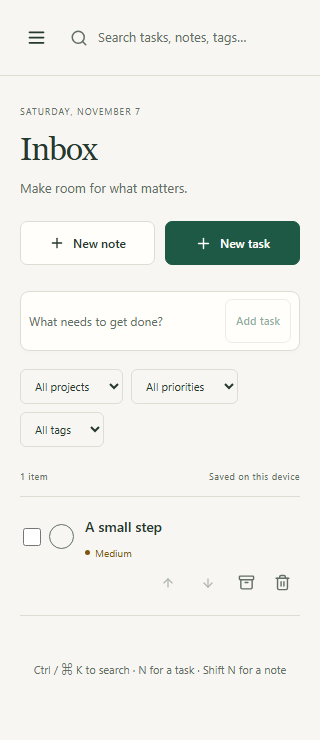

# Tasks & Notes

A local-first workspace for the things you need to do and the thoughts you want to keep. React,
TypeScript and IndexedDB; no account or backend required. Version: **1.0.0** (`package.json` is authoritative).
Desktop and mobile browsers; installable as a PWA. CI is configured but has not been run on GitHub.



Install from the browser menu → **Install app**, or **Share → Add to Home Screen** on supported mobile
browsers. This repository produces a web PWA; there is no native APK/EXE or hosted download. Local
production preview: **[Open Tasks & Notes](http://127.0.0.1:4173/)** after starting the commands below.
Use HTTPS for remote hosting; loopback HTTP supports local service workers.

| Capability   | Available behavior                                                                       |
| ------------ | ---------------------------------------------------------------------------------------- |
| Tasks        | Capture, edit, complete, priorities, due dates, reminders, checklists, move up/down      |
| Organization | Inbox, Today including overdue, Upcoming, All tasks, projects, tags, filters             |
| Notes        | Markdown, safe preview, formatting tools, autosave status, pins, Markdown export         |
| Recovery     | Bulk completion/archive/trash/restore, last-action undo, stale-edit detection            |
| Search       | All search words across titles, content, tags, checklist items and project names         |
| Portability  | Validated JSON backup and transactional, non-destructive import                          |
| Offline      | Cached production shell, install manifest/icons, prompted updates with editor protection |
| Preferences  | Light/dark/device themes, English/Spanish, completed task visibility                     |

## Quick start

Tested on Windows with Node **22.13.1**, npm **10.9.2**. Use Node 22.13+ or Node 24 LTS and npm.

```powershell
npm ci
npm run package
npm run preview
```

Open **http://127.0.0.1:4173/**. `preview` binds only to loopback and fails if its port is occupied.
Leave the command running. Stop it with Ctrl+C. For source editing, use `npm run dev` at
http://127.0.0.1:5173/; the production service worker is intentionally disabled in development.
There are no required environment variables. Vite reads standard `.env` files; `VITE_*` values are
public browser configuration and must never contain secrets.

Browser storage belongs to the **exact origin**: `localhost`, `127.0.0.1`, port 5173 and port 4173 each
have separate data. Use the same address consistently, or transfer a backup through Settings.

## Usage

- Type into quick capture and press Enter. Click a task title for details and use its circle to complete it.
- Press **N** for a task, **Shift+N** for a note, **Ctrl/⌘+K** to search. Shortcuts leave typing fields alone.
- Add a note title and start writing. Autosave runs after 650 ms idle; check its saved/error status.
  **Ctrl/⌘+S** saves immediately. Native textarea undo/redo works for typing. Markdown toolbar edits
  insert syntax; use the Write tab to edit checklist markers. Preview ignores HTML and external images.
- Use row checkboxes for bulk actions. Move-up/down buttons provide keyboard-accessible ordering.
- Archive hides finished material; Trash retains records for restore. Undo covers the most recent
  completion/archive/trash/restore operation and refuses to overwrite a newer edit.
- In Settings, export a backup regularly. Import accepts this app's schema-v2 JSON up to 20 MB.
  Exact records are skipped; conflicting records are preserved as separate copies. Projects are
  remapped to copied projects. Existing preferences stay in place; fresh workspaces import them.
- Enable reminders explicitly in Settings. They run while the app is open; alerts are not guaranteed
  when the app is closed, the device sleeps, or the browser blocks notifications.

## Build, verification and CI

```powershell
npm run format:check
npm run lint
npm run typecheck
npm run check:content
npm run check:source
npm run check:duplication
npm run coverage
npm run package
npm audit --audit-level=moderate
npx playwright install chromium
npm run test:e2e
```

`package` builds `dist/`, collects dependency licenses, checks JS size budgets and writes `SHA256SUMS`.
Serve the whole directory on a static HTTPS host with SPA fallback to `index.html`. Mirror the security
headers in `vite.config.ts`; Vite's preview headers do not configure another host. Verify checksums
against the locally reviewed package; they do not establish a publisher identity. Updates prompt for
reload and disable that action while an editor is open. Back up before upgrades. To roll back, serve
a previous compatible build and reload after closing editors; avoid older code after schema changes.

| Event               | Configured checks                                                                                                     | Publication     |
| ------------------- | --------------------------------------------------------------------------------------------------------------------- | --------------- |
| Push / pull request | Frozen install, formatting, lint, types, content, source, duplication, coverage, build, licenses, audit, Chromium E2E | None            |
| Weekly Dependabot   | npm and pinned GitHub Actions updates                                                                                 | Review required |

Local verification and exact results are recorded in [architecture](docs/ARCHITECTURE.md#12-dated-verification).
Thresholds are 90% individually for statements/branches/functions/lines, and 95% for storage and
reminder modules. Tests use isolated synthetic data. Screenshots come from real browser tests, not
production user records.

```text
src/
  models/       Validated task, note, project and preference contracts
  domain/       Dates, search, factories and safe errors
  db/           Additive migration, transactional commands and backup merge
  features/     Task/note editors, projects and settings
  hooks/        Draft serialization, live storage, shortcuts and platform integration
  ui/           Shared navigation, lists, dialogs, fields and feedback
  styles/       Semantic tokens, desktop/mobile and dark theme
public/         Single content model, original icon and generated PNG sizes
tests/          Domain/recovery/UI tests and production browser E2E
tools/          Content/source checks, icons, licenses, budgets and checksums
docs/           Architecture and actual browser screenshots
```

## Status and troubleshooting

The core local PWA is implemented. Optional sync/accounts, recurring tasks, attachments, encryption,
calendar/Kanban, backlinks and note version history are future work. Data is not encrypted at rest;
browser data clearing or eviction can remove it. Exported backups are plaintext. No analytics,
private-content uploads, remote fonts, AI or cloud integration are included.

Storage error: allow IndexedDB in the browser and retry; the app never resets storage automatically.
Save/quota error: keep the editor open, free space and retry. Stale-edit error: copy the draft, close,
and reopen the latest record. Import error: use a valid app export; invalid files change no records.
Offline unavailable: load the production app once online and allow its service worker to finish.
Port occupied: inspect its listener or choose a free port explicitly; never stop unrelated services.

The audit has four **low** development-tool findings from one unpatched `deepmerge` advisory in the
Workbox build chain. Runtime dependency audit is clean; moderate/high/critical counts are zero.
No screen-reader, physical-device, hosted-CI or field Web Vitals certification is claimed.

Architecture, contracts, design references and limits: [docs/ARCHITECTURE.md](docs/ARCHITECTURE.md).
Dependency notices: [THIRD_PARTY_NOTICES.md](THIRD_PARTY_NOTICES.md). The source license awaits the
owner's choice; no project license has been invented.
