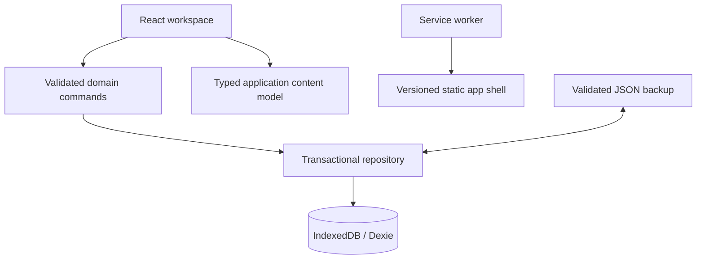

# Tasks & Notes architecture

Contents: [scope](#1-product-and-acceptance), [decisions](#2-architecture-and-adr-001),
[design](#3-design-discovery-and-adr-002), [verification plan](#4-verification-plan),
[references](#5-primary-implementation-references), [ownership](#6-source-ownership-and-platform-adapters),
[contracts](#7-data-contracts-and-recovery), [flows](#8-workflows-and-failures),
[security](#9-privacy-security-and-egress), [accessibility](#10-accessibility-and-performance),
[traceability](#11-requirements-traceability), [evidence](#12-dated-verification).

## 1. Product and acceptance

Personal workspace for students, independent makers and people organizing everyday work. Browser-only,
local-first React PWA; no account, backend, AI or telemetry. Complete milestones 1–4 of the supplied
specification. Cloud sync, attachments, encryption, boards and calendar are optional future extensions.

Acceptance: task CRUD/completion/subtasks/reordering/projects/priorities/dates/tags; Markdown notes with
autosave and safe preview; search; bulk actions; undo; archive/trash/restore; validated backup merge;
settings; reminders with honest permission/background limits; installable offline production build.
Preserve the existing `ProductivityDB` database and upgrade its schema without deleting records.

Owner: application modules in `src/`, tests in `tests/`, checks in `tools/`. Initial inspection on
2026-11-06: no Git repository/revision, no existing lockfile/tests/styles/CI. Existing build fails with
TS1003/TS1382 from HTML comments inside JSX. Dependency audit: five findings, including two critical.

Hypothesis: the original scaffold cannot build. Executed `npm install --ignore-scripts` then
`npm run build`: disproving check confirmed the build failure. Next falsifiable check: a task and note
saved through the UI survive reload, export/import and an offline reload in a clean browser profile.

## 2. Architecture and ADR 001

Keep React + strict TypeScript + Vite + Dexie. Separate validated domain contracts, transactional
repositories and React views. Retain database name and v1 schema. Add a versioned additive migration.
Prefer Markdown + react-markdown (MIT) over TipTap/ProseMirror: plain portable content, native textarea
undo/redo, lower editing complexity. Raw HTML and remote images are disabled; links are sanitized.
No motion/scroll framework: native focus, scrolling and reduced-motion-aware CSS fit this workspace.
Upgrade vulnerable build/test dependencies; use the existing npm package manager and one lockfile.
Operational cost: static files only. Exit: JSON export and Markdown; adapters can be replaced later.

## 3. Design discovery and ADR 002

Actual official pages opened on 2026-11-06. Patterns are observations from published pages; these are
proprietary products, with no permission to reuse their artwork, layouts, trademarks or source.

| Reference                        | Observed pattern / fit                                              | Tradeoff and accessibility                                       | Reuse license                 |
| -------------------------------- | ------------------------------------------------------------------- | ---------------------------------------------------------------- | ----------------------------- |
| https://www.todoist.com/features | Quick capture, priorities, labels, focused Today/Upcoming views     | Dense metadata needs named controls and keyboard alternatives    | Proprietary; inspiration only |
| https://culturedcode.com/things/ | Quiet hierarchy, task-first navigation, projects, device adaptation | Sparse controls can hide capabilities; keep actions discoverable | Proprietary; inspiration only |
| https://obsidian.md/             | Device-local Markdown, tags, portable knowledge                     | Editor complexity can distract; use explicit edit/preview        | Proprietary; inspiration only |

Compared cool, compact developer workspace versus warm paper-and-ink organizer. Choose the latter:
ivory canvas, dark green accent, ruled lists, serif page titles, system sans controls, restrained amber
for notes. Original composition, no copied assets or downloaded fonts. No decorative media required.
Typography: 14–16px controls/body, 32–40px page titles; 4/8px spacing scale; readable 76rem workspace.
Desktop: 240px sidebar + list/editor. Narrow: collapsible navigation + full-width content/editor.
Screens: Inbox, Today, Upcoming, All tasks, Notes, Projects, Archive, Trash, Settings, global Search.
Flow: quick-add -> optional details -> save -> complete/archive/trash -> undo/restore. Notes save
after typing with visible status and retained drafts on failures. Dialogs contain focus and restore it.
Empty/loading/error/offline/success states are explicit; no fabricated starter records.

## 4. Verification plan

Run domain/repository tests first, then lint, strict typecheck, formatting, coverage, production build,
dependency audit, duplication/secret checks and browser E2E. Verify desktop and 320px reflow, keyboard,
safe Markdown, backup downloads/import, migration and offline reload. Use isolated synthetic browser
data. Coverage targets: 90% four metrics, 95% critical state modules; report actual gaps without lowering
thresholds. Native packaging and hosted CI are outside this local PWA delivery; do not claim execution.

## 5. Primary implementation references

Checked 2026-11-06: https://vite.dev/guide/ (Node compatibility),
https://dexie.org/docs/Version/Version.upgrade() (versioned migrations),
https://vite-pwa-org.netlify.app/guide/prompt-for-update.html (prompted shell updates),
https://github.com/remarkjs/react-markdown#security (safe rendering). Registry metadata was checked for
the actual installed tool versions; the lockfile is authoritative.

## 6. Source ownership and platform adapters

| Responsibility                                                    | Owner                                                |
| ----------------------------------------------------------------- | ---------------------------------------------------- |
| Typed external/local record validation and limits                 | `src/models/task.ts`                                 |
| Local/UTC dates, search/view/ordering semantics                   | `src/domain/`                                        |
| Dexie v1 compatibility and v2 migration                           | `src/db/database.ts`                                 |
| State transitions, optimistic concurrency and atomic bulk changes | `src/db/repository.ts`                               |
| Backup contract, validation and non-destructive merge             | `src/db/backup.ts`                                   |
| Serialized editor saves and before-unload protection              | `src/hooks/useDraft.ts`                              |
| Live-query lifecycle, retries and composition                     | `src/hooks/useWorkspace*.ts`                         |
| Foreground notifications, downloads, theme/connectivity           | `src/platform/`, `src/hooks/usePlatform.ts`          |
| UI state and fields                                               | `src/features/`, `src/ui/`, `src/App.tsx`            |
| Authored copy, language and bundled fallback                      | `public/tasksandnotes.model.json`, `src/content.tsx` |
| Offline shell/manifest generation and update prompts              | `vite.config.ts`, `src/ui/PwaNotice.tsx`             |

No network API, authorization server, server migrations, credentials, queues, remote logs or cloud
adapters exist. Those conditional sections of the rulebook are N/A to this release. Storage is owned
by the current browser origin/profile. Development and production ports intentionally have separate data.

## 7. Data contracts and recovery

App version is in `package.json`; IndexedDB version and backup schema version are both 2, independently
versioned. `ProductivityDB` keeps v1's tasks/notes/projects tables. V2 adds preferences, multi-entry task
tag indexing, and fills note Markdown/archive fields. It removes the unusable boolean pinned index;
pinned sorting is performed on read. Migration tests preserve existing v1 notes. No destructive reset.

Task IDs, project IDs, note IDs and checklist IDs are UUIDs. Timestamps are UTC ISO instants. A due date
always includes a time; there is no ambiguous date-only UTC conversion. Device-local Today includes
overdue tasks; Upcoming starts after the current local day. Invalid/normalized wall times and DST spring
gaps are rejected. Fall-back ambiguity chooses the browser's first occurrence; stored UTC preserves it.
Changing the device time zone changes display/local day membership, not the stored instant.

Limits: task/note titles 240 characters; project names 80; tags 30 per record, 40 characters each;
checklist 100 items; task descriptions 100,000 characters; note body 1,000,000 characters. Backup input
is capped at 20 MiB, 50,000 tasks, 50,000 notes and 1,000 projects, with strict field/UUID/enum/date checks,
unique identifiers and project references. Tags are record-local vocabulary; dedicated Tag, Attachment
and ChangeLog stores are unnecessary for the implemented scope. Reminder state is colocated with tasks.

Repository saves compare `updatedAt` inside a read/write transaction. Stale editors cannot overwrite
newer content. Bulk commands and undo roll back completely on conflicts. Increasing timestamps also
distinguish two operations within the same millisecond. Row completion toggles; bulk completion is
idempotent. Archive restore returns tasks to To do; trash restore preserves the previous status.
Reordering swaps positions and normalizes order values in one transaction, including imported ties.
There is one session-local undo record; it is not a durable revision history.

Export is a read transaction. Import validates all records before opening its write transaction;
canonical schema normalization avoids false conflicts from JSON property order. Equal records are
skipped. Existing conflicting content is never overwritten: new UUID copies are created and copied
project references remapped. Existing settings win; an empty preferences table accepts imported settings.
Storage eviction/clearing has no automated recovery: restore a previously downloaded backup.

## 8. Workflows and failures

Task capture writes a validated record and clears the input only after success. Dialogs expose all task
fields; cancellation protects dirty input. Notes serialize saves so typing during a pending write is
retained for the following save. Autosave runs after 650 ms idle with a nonempty title; errors preserve
the draft and offer retry. Close saves dirty notes; deliberate Cancel can discard. Native before-unload
protection is best effort (mobile OS termination may not fire it). Textarea typing supports native
undo/redo; toolbar insertions do not implement a separate editor undo history.

Search matches all whitespace-separated words, case-insensitively, over titles, descriptions, bodies,
tags, subtasks and project names. It includes archived records and excludes trash. Filters further
restrict results. This is bounded in-memory substring search over IndexedDB data, not a linguistic
search engine. Move controls provide accessible ordering instead of drag-only interaction.

PWA precaches the static shell and lazy editor chunk. It does not cache user records or remote
responses. Updates wait and prompt; the reload control is disabled while any editor is open. Notes,
tasks and preferences remain in IndexedDB across shell updates. The isolated update browser test
serves two byte-distinct actual service workers and verifies waiting/activation with a task draft.

Foreground reminder checks run every 15 seconds and on visibility changes. Permission must be granted
by the user. A transaction suppresses duplicate reminders between tabs. Successful notification
delivery is recorded without changing editor revision; ordinary edits preserve that bookkeeping.
Permission/platform failures are visible. Alerts are best effort: app closure, sleep, throttling or
notification-center behavior can delay/prevent them. No background push service is implied.

## 9. Privacy, security and egress

| Data                                        | Destination                  | Purpose / trigger                          | Retention / control                                             |
| ------------------------------------------- | ---------------------------- | ------------------------------------------ | --------------------------------------------------------------- |
| Static app files and public translated copy | Same-origin static host      | Opening/updating the app                   | Service-worker cache; browser storage controls                  |
| Tasks, notes, projects, preferences         | Origin-scoped IndexedDB only | Explicit capture/edit/import               | Until browser data is cleared; archive/trash remain recoverable |
| Full backup / Markdown                      | User's download destination  | Explicit export                            | User-controlled, plaintext                                      |
| Task title in notification                  | Device notification center   | Explicit permission and scheduled reminder | OS-controlled history/settings                                  |
| Note links                                  | Destination selected by user | Explicit link click                        | Destination's policy; no-referrer link behavior                 |

Assets: private writing and recovery backups. Actors: the device owner, someone with access to the
browser profile, malicious imported content or same-origin script. Boundaries: file import, Markdown
rendering, origin storage and notification permissions. React escapes text; preview skips HTML, excludes
images and uses react-markdown's default URL sanitation. No raw HTML plugin, eval or remote content
execution. Zod validates persisted writes and imports. Error output uses authored safe messages;
private payloads are not logged or uploaded. A basic source secret-pattern scan is included, with
explicit limits rather than a claim of a complete secret scan.

Preview sets a same-origin CSP, nosniff, no-referrer and restrictive camera/microphone/geolocation
permissions. Inline styles remain permitted for authored project-color swatches. Hosting elsewhere must
set equivalent HTTP headers and HTTPS; HSTS belongs to the HTTPS host. No authentication is needed for
this local profile application. Same-profile access and same-origin XSS can read IndexedDB: there is no
encryption-at-rest or account isolation claim. Export files should be stored securely by the owner.

Dependency audit: production dependencies have zero findings. Four low build-tool findings trace to
`deepmerge` 4.3.1, via Workbox/Rollup; the registry has no patched release. The unsafe object merge is
not reachable from note/backup data, which stays in the browser. Current official upstream build tools
are retained, with no downgraded security tooling. Minimatch/glob overrides select patched releases;
lint/build/tests verify their compatibility. Revisit these narrow overrides on dependency upgrades.

## 10. Accessibility and performance

Semantic native dialog, form labels, checkboxes, navigation and landmark regions; visible focus;
keyboard shortcuts skip typing fields; native modal focus containment and restoration. Mobile navigation
collapses at 720px, fields become one column, row actions reflow and CSS uses logical spacing. Motion
is limited to color transitions and respects reduced-motion preferences. English and Spanish have exact
key/placeholder parity, typed access, locale-aware dates/numbers/plurals, validated external loading and
a bundled fallback generated directly by importing the same JSON. Unknown locales fall back to English.
No RTL-language translation ships; the layout uses logical properties and should be verified before
adding an RTL dictionary. Text is authored exclusively in the app-named content model; build metadata
derives from it. Code error diagnostics are internal implementation messages, never user copy.

Budgets: <=200 KB gzip initial JS, <=500 KB per JS chunk, <=1 MB essential precached shell; no external
fonts/images/analytics. Lazy-loading Markdown keeps it out of initial JS. Measured production output:
initial JS approximately 122 KB gzip, Markdown/editor chunk approximately 51 KB gzip, shell approximately
603 KiB. Browser tests verify real behavior, not field performance. Field LCP/INP/CLS, screen readers,
physical devices and large-vault performance remain unmeasured; no WCAG certification is claimed.

Lint enforces cyclomatic complexity <=10, cognitive <=15, nesting <=3 and 120-character source lines
(long string/template/URL literals excepted). Source files stay below 400 lines. JSX composition may
exceed 50 physical lines: it contains declarative markup rather than deeply nested domain decisions.
Duplication measured 0.40%, below the 3% target. These checks do not establish code correctness alone.

## 11. Requirements traceability

| Capability / acceptance                       | Owner                         | Status and evidence                                                         | Risk                                               |
| --------------------------------------------- | ----------------------------- | --------------------------------------------------------------------------- | -------------------------------------------------- |
| Scaffold, models, local storage, upgrades     | models + db                   | Verified; repository and migration tests                                    | Browser eviction remains possible                  |
| Tasks, metadata, subtasks, projects, ordering | tasks + projects + repository | Verified; UI/domain/browser tests                                           | Large vault performance unmeasured                 |
| Undo, bulk, archive, trash and restore        | repository + WorkspaceList    | Verified; stale/bulk rollback and UI tests                                  | Undo is session-local and last action only         |
| Notes, tags, pins, safe preview, autosave     | notes + useDraft              | Verified; UI and malicious Markdown browser tests                           | Abrupt OS closure can lose the last unsaved input  |
| Search and filters                            | domain/query + Filters        | Verified; content/subtask/project and UI tests                              | Substring search, no stemming                      |
| JSON export/import and rollback               | db/backup                     | Verified; duplicate/conflict/size/reference tests and clean-browser restore | Plaintext exports                                  |
| PWA, offline shell and safe update            | VitePWA + PwaNotice           | Verified in Chromium, real offline reload/update lifecycle                  | Install UX varies by browser                       |
| Foreground reminders                          | platform/reminders            | Verified with controlled notifications and suppression/failure tests        | Real OS display not observed; app must remain open |
| Settings and localized content                | SettingsView + content model  | Verified English/Spanish switching, fallback and contract tests             | No RTL translation                                 |
| Optional phase-2 sync and advanced features   | Future adapters               | N/A to local MVP; not implemented                                           | Requires separate product/security decisions       |

## 12. Dated verification

Latest local verification **2026-11-07**, Windows, Node 22.13.1/npm 10.9.2. Initial Git checks reported no repository;
final inspection reports an unborn `main` branch with no commits or remotes. No revision hash, agent
commits, pushes or hosted CI runs exist. All runtime records used in verification are synthetic in
isolated test databases/browser profiles. The user's browser profile was not modified by the tests.

- Baseline `npm run build`: failed with invalid JSX; baseline audit had 5 findings (2 critical).
- `npm ci`: passed after stopping the task-owned preview process, which initially locked a Windows
  native build-tool binary. No unrelated process was stopped.
- `npm run coverage`: 34 tests passed; statements 97.36%, branches 94.04%, functions 96.91%,
  lines 98.11%, with no source exclusions. Storage modules are 100% lines/functions/statements;
  repository branches are 98.27%, other storage modules and reminders are 100%.
- `npm run test:e2e`: 5 workflows passed, covering CRUD, safe preview, archive/trash/restore, actual backup
  download and import into a clean browser, offline reload, 320px layout, keyboard focus, axe checks,
  and a real service-worker waiting/activation cycle. Adaptation checks include dark mode, reduced
  motion, 200% computed text resizing, RTL layout and importing/editing/saving a 220,000-character note.
  A persistent-profile test closes Chromium completely, reopens it with networking disabled, and
  verifies the saved task, note body, tags and offline app shell without touching the user's profile.
  Screenshots inspected at desktop and mobile. An initial stress test pasting that entire note timed
  out; a plain native textarea also exceeded 5 seconds for that paste. Large-note verification uses
  the real import flow instead; fast giant native pastes are not claimed. CSS zoom was replaced by
  direct text resizing because CSS zoom does not model browser text resize/native dialog geometry.
- Typecheck includes source, test and build configuration. Lint, formatting, content parity/duplicate
  key detection, source bounds, build budgets and checksums are local gates, not hosted evidence.
- `npm audit --omit=dev`: zero findings. Full audit: four low development-tool findings, no
  moderate/high/critical findings. License inventory: 111 runtime packages, none with unknown licenses.
- `npm run format:check`, `npm run lint`, `npm run typecheck`, `npm run check:content`,
  `npm run check:source`, `npm run check:duplication`, `npm run package` and
  `npm audit --audit-level=moderate`: passed. CI/Dependabot YAML parsed with the installed YAML parser;
  all packaged SHA-256 entries were recomputed and matched. GitHub execution remains unrun.

The source has no remote deployment. Deploy only after reviewing this matrix and the static host
headers. To extend: add validated fields and a forward migration, put invariants in the repository,
add content keys to both locales, cover upgrade/failure paths, then run the same checks and browser
workflows. Do not change database identity or clear records as a workaround. Native wrappers, cloud
sync, account authorization and durable background reminders require separate ADRs and acceptance.
